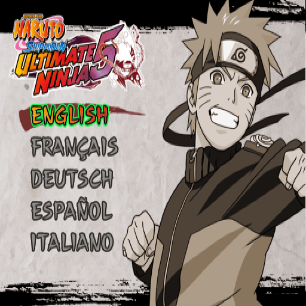

# Phase 2: boot on the Mac (in progress)

Goal: reach the title screen on macOS arm64 and measure GS/VU1 cost.

## Where it stands (2026-10-26)

On upstream PS2Recomp (`e563698`) plus three local patches, the game:

1. runs all 19 static constructors;
2. initialises SIF RPC, programs the GS and installs its VSync callback;
3. **loads its own IOP modules in the IOP emulator**: `SNDBASE.IRX`
   ("sound driver version 0.2.0") and `CRI_ADXI.IRX` ("CRI ADX Driver
   Ver.9.69");
4. **finds every file on the disc** through `sceCdSearchFile`;
5. creates its eight threads with the right priorities, and **its main loop
   runs**: the VSync callback wakes the frame thread every frame, and the
   game-logic thread (`0x12E9E8`, priority 122) starts;
6. issues its first GS draws (textured sprites).

7. keeps its main thread alive and **loads data**: dozens of `sceCdRead`
   calls walk `DATA.CVM`; nine EE threads run, including CRI's;
8. **streams graphics work to VU1**: in 45 s, 2,461 DMA transfers and 4,918
   VIF writes.

9. runs its loader thread every frame, loads the sound bank, and reaches
   its **first screen**: a five-item menu at `0x3D0C60` (up/down moves, a
   confirm button picks an entry from the table at `0x5BA4C0`): the PAL
   **language select**.

10. **draws the whole language menu**.

The menu's sprites had been projected with an all-zero screen matrix. The
game builds identity matrices from `VF0`, which the VU hardwires to
`(0, 0, 0, 1)`, but every EE thread's context started with `VF0` zeroed.
With that fixed the matrix scales by 16 and 18.67 and offsets to
`(0x7000, 0x7200)`, as a 512x448 screen should.

That first showed only two strips of the menu ([first frame](first-pixels.png)).
The game presents each frame by copying its draw buffer (fbp 0) to the
display buffer with the Z buffer pointed at fbp 0 but switched off
(`TEST.ZTE = 0`). The CPU renderer ignored ZTE and wrote depth anyway,
erasing the draw buffer while copying it.

## What it took

| Stop | Cause | Fix |
|---|---|---|
| `missing-target 0x5e3a00` from `func_11A0B0` | Static constructors are only reached through the table at `0x5E7210`; the code range there was set too small (`0x5E3B50`) | Range is `0x5E3A00`-`0x5E7210`; the constructor table is read and seeded |
| `J 0x1a1bc0`, `JALR 0x1a1da0`, `JALR 0x122b60` | Tail calls and callbacks into code Ghidra left as labels, which phase 1 dropped | Ghidra's 53,000 labels plus 344 pointer/jump seeds go back in as **entry points**: inside a known function each becomes a cheap resume entry, outside one a bounded function. 10,285 files, 0 errors |
| Loop on "Libcdvd bind err CdSearchFile" | `0x1733C0` is `sceCdLayerSearchFile`; the runtime only has `sceCdSearchFile`, so the game's own libcdvd ran and waited for cdvdfsv's RPC server `0x80000597` | Runtime handler, patch `0003` |
| All EE threads asleep, nobody wakes them | The analyzer saw one ELF section spanning code and data and **replaced 32 stores with NOPs as "potential self-modifying code"**; they write globals. One held the idle thread's priority, so its value stayed 0 and the idle busy loop starved every other thread | Analyzer fix, patch `0002` |
| Game-logic thread never started; main thread "restored" to priority 0 | `ChangeThreadPriority` returned `KE_OK` (0); the EE kernel returns the old priority, which the game saves and restores around a critical section | Patch `0001` |
| CRI ADX waits on SPU2 transfers forever | No libsd for IRX modules: `sceSdBlockTrans` never completes, the transfer interrupt never fires | Patch `0004`: transfers drain at 48 kHz stereo rate, the handler from `sceSdSetTransIntrHandler` fires per half buffer |
| `CreateThread` refused with -403 | The runtime rejects priority 0 (`< 1`), the IOP's rule; the EE takes 0-127 and runs its own main thread at 0 | Patch `0001` |
| Main thread ends with `ra = 0`, loader never kicked again | Async callback stacks (16 KB each, carved down from the top of RAM) landed on `SetupThread`'s automatic main stack from the third one on, overwriting its saved return address while it slept | Patch `0007`: callback stacks start below the main stack |
| Bogus `MSCAL 0x829D`, VU1 runs empty code | VIF1 swallowed the `DIRECTHL` VIFcode that carried the rest of a GIF IMAGE as image data; the stream slipped 8 bytes and texture data was parsed as commands | Patch `0009`: the image is fed from following DIRECT payloads |
| Loader thread never runs | `ResumeThread` and the other thread calls returned `KE_OK`; the EE kernel returns the thread ID, and the game wakes its loader only if `ResumeThread(id) == id` (confirmed against the Play! HLE kernel) | Patch `0010` |
| `CD READ Fail...(COMM_HD)`, no sound driver | The IOP's `sceCdRead` refused destinations no allocation had touched; SNDBASE reads its sound bank header to a fixed buffer at `0x1BA400` | Patch `0012`: only the bounds are checked |
| Menu drawn to nowhere: every sprite projected to (0, 0) | New thread contexts had `VF0` = 0; the screen matrix is built from it | Patch `0013` |
| Only two strips of the menu | The GS renderer ignored `TEST.ZTE = 0` and wrote depth into the buffer being presented | Patch `0014` |
| Pad never answers: the language menu ignores every button | `scePadRead` reported ID `0x73` after `scePadEnterPressMode`; a DualShock 2 in pressure mode reports `0x79`, and the game restarts its pad setup until it does | Patch `0015` |
| Movie stops on the CRIWARE logo | The game's `malloc` took the whole guest heap, so the runtime could not allocate libmpeg callback data and dropped every audio packet; the player waits for audio before it shows video | Patch `0017`: the game's allocations leave a reserve |
| The game crawls | `PS2X_ENABLE_AGRESSIVE_LOGS` also flushed a log line per guest call (194 MB a minute) | Patch `0011`: separate, off by default |
| Precompiled header errors on rebuild | The generated headers are in the runner's PCH and ninja does not rebuild it | `tools/build_mac.sh` drops the PCH when they change |

Seeds come from: the constructor table, data words that point at a function
start (a stack prologue, or right after a `jr $ra`/`j` and padding), slots
next to known function pointers (vtables), `lui`/`addiu` pairs that build a
function address in code, and `J`/`JAL` targets outside their own function.

## Changes to PS2Recomp

Kept as a commit series on branch `un5-nx` of `third_party/PS2Recomp`,
exported with `git format-patch` to `patches/ps2recomp/` and applied by
`tools/setup_ps2recomp.sh`. Each fix has a test; the full suite (451 runtime
tests, now 455, plus the IOP suites) passes, and the new tests fail without their fix.

| Patch | What |
|---|---|
| `0001` fix(runtime) | EE thread priority 0 is valid; `ChangeThreadPriority` returns the old priority |
| `0002` fix(analyzer) | A "self-modifying" store must write into the function its jump enters; before, 32 ordinary stores to globals became NOPs |
| `0003` feat(runtime) | `sceCdLayerSearchFile` handler (forwards to `sceCdSearchFile`) |
| `0004` feat(iop) | Minimal libsd for IRX modules: no sound, but the SPU2 transfer clock and interrupts |
| `0005` tools | `UN5_FRAME_DUMP=<absolute dir>` writes every 30th presented frame as a PPM |
| `0006` tools | Thread, semaphore and `UN5_WATCH=0xADDR,...` memory diagnostics on each run tick |
| `0007` fix(runtime) | Async callback stacks no longer overlap the automatic main stack |
| `0008` tools | Disc reads, and threads reaching pc 0 (with dispatch history), are logged |
| `0009` fix(runtime) | VIF1 keeps DIRECT commands when a GIF image spans them |
| `0010` fix(runtime) | Thread calls return the thread ID on success |
| `0011` tools | Function log tracker off by default; display circuits and VRAM use logged |
| `0012` fix(iop) | IOP `sceCdRead` may fill RAM the module never allocated |
| `0013` fix(runtime) | Every `R5900Context` starts with `VF0` = (0, 0, 0, 1) |
| `0014` fix(gs) | `TEST.ZTE = 0` turns the Z buffer off (no depth test, no depth write) |
| `0015` fix(pad) | Pressure mode reports the DualShock 2 ID `0x79` |
| `0017` fix(runtime) | The game's `malloc` leaves a heap reserve for the runtime's own allocations |
| `0016` tools | `UN5_PAD_SCRIPT="tick:button[+button]:frames,..."` presses buttons on port 0 for scripted runs |

With the analyzer and runtime fixed, `tools/fixmap.py` no longer filters
the analyzer's patches or binds `sceCdLayerSearchFile` itself; the
recompiled output is identical apart from that call now using its own name.

`0001`, `0002`, `0003`, `0007`, `0009`, `0010`, `0012`, `0013`, `0014`, `0015` and `0017` are meant for upstream
(the Sinan-Karakaya fork used by DQ8-Recompiled has none of them either); the GitHub account is flagged at
the moment, so they wait here.

## Next

1. Confirming the language plays `PSS/LOGO_C.PSS` and starts
   `PSS/NARUTO10.PSS` (the CRIWARE logo) with its audio. About 1,000 frames
   in, the picture goes black and no new frame reaches the window: GIF
   transfers stop at 1,131 while the EE keeps running and the window loop
   idles normally. Next: find what stops frame output after the movie.
   Repeat with `UN5_PAD_SCRIPT="600:cross:8"`.
   `tools/debug-traces.diff` keeps temporary traces (GS primitives, VIF1
   chain dump); `tools/decompile.sh out.c <hex addr>...` decompiles functions
   from the phase 1 Ghidra project.
2. Look at [z3xox/BT3-Recomp](https://github.com/z3xox/BT3-Recomp)'s native
   `cri_adxi` (same IOP module, GPL-3.0) and
   [ico-pc](https://github.com/nathanialf/ico-pc)'s software SPU2 (MIT) for
   real sound. More leads in [`REFERENCES.md`](REFERENCES.md).
